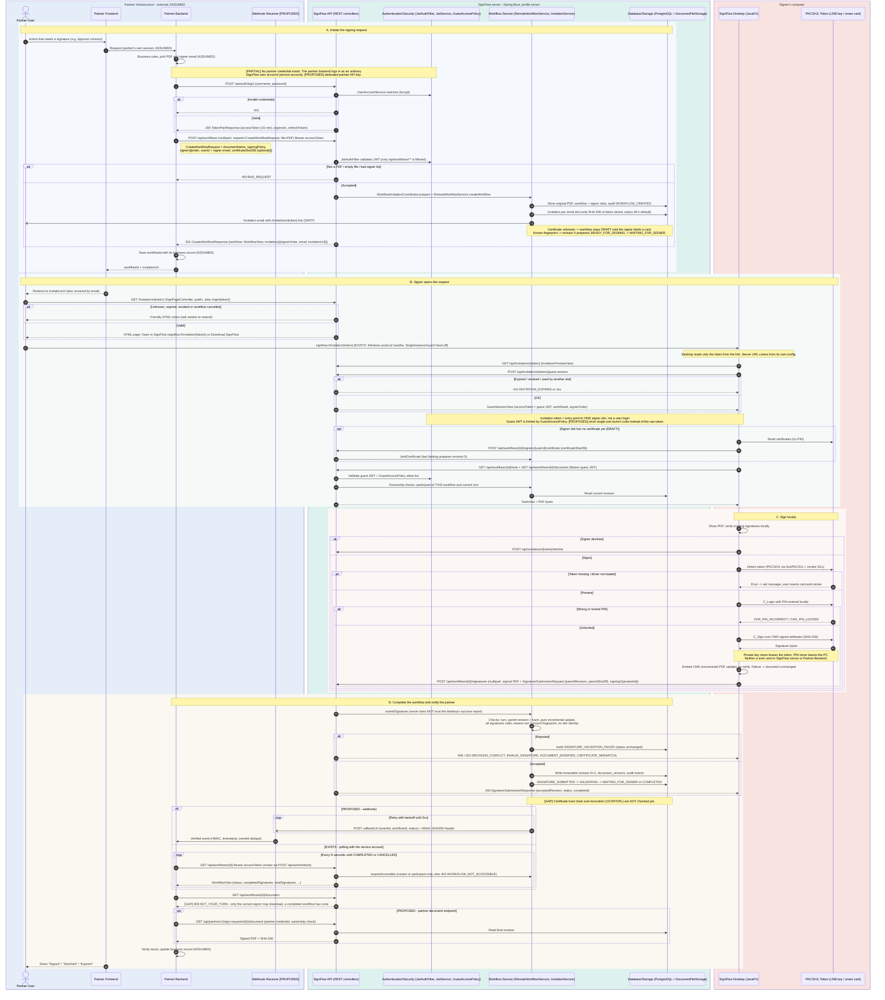

# Partner backend ↔ SignFlow server integration

Status: October 2026. Checked against the SignFlow code (`src/main/java/com/example/signer/**`,
Flyway `V1`–`V4`). The partner's application is **not** in this repository, so everything on the
partner side is marked **Assumed**.

**Legend:** **Implemented** = in the code and used · **Partially implemented** = works, with
limits · **Proposed** = not built · **Unknown / Assumed** = outside this repository.

## 1. The two-server architecture
- **Partner system** (external): a web or client front end and a backend server. It owns the
  business record (e.g. a contract) and decides when a signature is needed.
- **SignFlow system**: a Spring Boot server (profile `server`) that owns the **signing workflow,
  its state and every PDF revision**. The JavaFX desktop app runs on the signer's PC and is the
  only component that talks to the USB token / smart card (PKCS#11).

The two servers talk over HTTPS REST. The signer's browser only opens an invitation page, and
that page launches the desktop app through the `signflow://` protocol.

**SignFlow has no dedicated partner API today.** The integration below uses the
existing user-facing API, with the partner backend signed in as an ordinary SignFlow account
(a "service account"). That is why most of section A is **Partially implemented**.

## 2. Sequence diagram

Rendered copies: `partner-server-integration.svg` and `.png`. The `.mmd` file is the editable source.

## 3. Responsibilities
| Partner system (Assumed) | SignFlow system |
|---|---|
| Decides which business action needs a signature | Creates the workflow and its signer slots |
| Chooses the PDF and the signer's email | Generates invitations (only token hashes stored) and emails them |
| Calls the SignFlow API from its **backend** | Serves the invitation page and launches the desktop app |
| Redirects its user to the invitation URL | Desktop: shows the PDF, talks to the card through PKCS#11, signs locally |
| Polls the status (webhook proposed), updates its record | Validates every signed upload on the server, stores revisions, updates state |

**Who owns what:** SignFlow owns the workflow state (`workflows.status`) and every PDF revision,
including the final signed document (files under `signature.remote-server.storage`, with hashes
in `document_versions`). The partner keeps only the `workflowId` and its own business status.

## 4. Existing endpoints and authentication used in this flow
| Step | Method and path | Auth | Request → response (DTOs in `ApiContracts`) | Status |
|---|---|---|---|---|
| Partner login | `POST /api/auth/login` | none (credentials in body) | `LoginRequest{username,password}` → `TokenPairResponse{accessToken, expiresIn, refreshToken}` | Implemented |
| Token renewal | `POST /api/auth/refresh` | refresh token | `RefreshRequest` → `TokenPairResponse` (rotation, reuse detection) | Implemented |
| Create workflow | `POST /api/workflows` (multipart `request` + `file`) | Bearer access JWT | `CreateWorkflowRequest{documentName, signingPolicy, signers[{order, userId, certificateSha256}]}` → `CreateWorkflowResponse{workflow: WorkflowView, invitations[{signerOrder, email, invitationUrl}]}` | Implemented |
| Extra / resend invitation | `POST /api/workflows/{id}/invitations`, `POST /api/invitations/{invitationId}/resend` | Bearer JWT (owner) | `CreateInvitationRequest` → `InvitationView` | Implemented |
| Status | `GET /api/workflows/{id}` | Bearer JWT, creator or participant | → `WorkflowView{status, completedSignatures, totalSignatures, currentSignerUserId, …}` | Implemented (polling) |
| History | `GET /api/workflows/{id}/revisions`, `/audit` | Bearer JWT, creator or participant | → `RevisionView[]` (hashes, no bytes), `AuditView[]` | Implemented |
| Cancel | `POST /api/workflows/{id}/cancel` | Bearer JWT, owner only | → `WorkflowView` | Implemented |
| **Final signed PDF** | `GET /api/workflows/{id}/document` | Bearer JWT | Returns the PDF **only to the signer whose turn it is**. The owner, or anyone after COMPLETED, gets `409 NOT_YOUR_TURN` | **Gap** |
| Invitation page | `GET /invitations/{token}` (alias `/sign/{token}`) | the token itself | HTML: "Open in SignFlow" (`signflow://invitation/{token}`) or download | Implemented |
| Guest session | `GET /api/invitations/{token}`, `POST /api/invitations/{token}/guest-session` | the token itself | → `InvitationPreviewView`, `GuestSessionView{accessToken = guest JWT, …}` | Implemented |
| Decline | `POST /api/invitations/{token}/decline` | the token itself | | Implemented |
| Bind certificate | `POST /api/workflows/{id}/signers/{userId}/certificate` | Bearer (guest) JWT, own slot only | `BindCertificateRequest{certificateSha256}` | Implemented |
| Task + PDF | `GET /api/workflows/{id}/task`, `GET /api/workflows/{id}/document` | Bearer (guest) JWT | → `TaskView`, PDF bytes | Implemented |
| Submit signature | `POST /api/workflows/{id}/signatures` (multipart) | Bearer (guest) JWT | signed PDF + `SignatureSubmissionRequest{parentRevision, parentSha256, signingOperationId}` → `SignatureSubmissionResponse{acceptedRevision, status, completed}` | Implemented |

**Security filters:** since security Phase 2, Spring Security checks `Authorization: Bearer` on every non-public route (the diagrams above still show the earlier `JwtAuthFilter`).
Guest tokens are limited by `GuestAccessPolicy` to one workflow and one signer slot.
`/api/auth/**`, `/api/invitations/**` and `/invitations/{token}` are public, and the token in the
path is the capability.

## 5. Information exchanged between the servers
- **Partner → SignFlow:** service-account credentials (at login only), the original PDF, document
  name, signing policy, each signer's email and optionally a certificate SHA-256 fingerprint.
- **SignFlow → Partner:** `workflowId`, the workflow status, `invitationUrl` per signer (returned
  only once, in the create response), and later the status and revision hashes when polled.
- **Never exchanged:** the signer's PIN, the private key, the raw token hash, or the signer's
  guest JWT.

## 6. Security mechanisms

| Mechanism | Status |
|---|---|
| bcrypt password check, HS256 access JWT (15 min), rotating refresh tokens with reuse detection | Implemented |
| Workflow ownership: creator or participant only (`requireAccessible` → 403 `WORKFLOW_NOT_ACCESSIBLE`) | Implemented |
| Invitation tokens: 256-bit random, only SHA-256 stored, expiry (48 h default), resend/revoke, one live token per slot | Implemented |
| Guest JWT scoped to one workflow and one slot (`GuestAccessPolicy`) | Implemented |
| Server-side validation before accepting a signature: incremental-only bytes, all signatures valid, newest certificate = bound fingerprint, no dev identity, parent revision + hash, idempotent `signingOperationId` | Implemented |
| Desktop takes only the token from a deep link and uses its configured server URL | Implemented |
| Private key on the token, PIN only on the signer's PC | Implemented |
| A partner-specific credential (API key / client credentials) instead of a user password | **Proposed** |
| Certificate trust chain and revocation (OCSP/CRL) | **Proposed** (today `TrustStatus.NOT_VERIFIED`) |
| Short single-use launch code instead of the raw invitation token in the deep link | **Proposed** |
| Webhook with HMAC-SHA256, timestamp, event id, retries (transactional outbox) | **Proposed** |
| Rate limiting on login and invitation endpoints | **Proposed** (none found) |

## 7. Missing components for production partner integration
1. **Partner credential and authentication filter.** Today the partner must hold a user password and refresh JWTs.
2. **A document endpoint for the owner/partner** that returns the final signed PDF after `COMPLETED`, with an ownership check. This is the main functional gap.
3. **Webhooks**: an outbox table, a dispatcher, HMAC signing, retries and a delivery log. Until then, polling `GET /api/workflows/{id}` is the only way to follow progress.
4. **Partner-level fields**: an `externalRef`, a callback URL, an allow-listed return URL, and an idempotency key on create, so a retried create does not make a second workflow.
5. **Certificate trust and revocation validation** before a workflow can be reported as signed.
6. **Launch codes** instead of the long-lived invitation token in links.
7. **A public HTTPS deployment** and an installer that registers `signflow://`.
8. **Service-account provisioning.** It is **unknown** how a partner account would be created: registration (`POST /api/auth/register`) is invitation-bound, and the development seeder only runs in dev.

## 8. Assumptions (partner side)
- The partner backend can make HTTPS calls, store a `workflowId`, and keep a credential secret.
- The partner frontend can redirect its user to a URL.
- The signer has SignFlow Desktop and the card driver installed, or follows the download link.
- The partner's own user authentication and business rules are outside SignFlow's scope.
